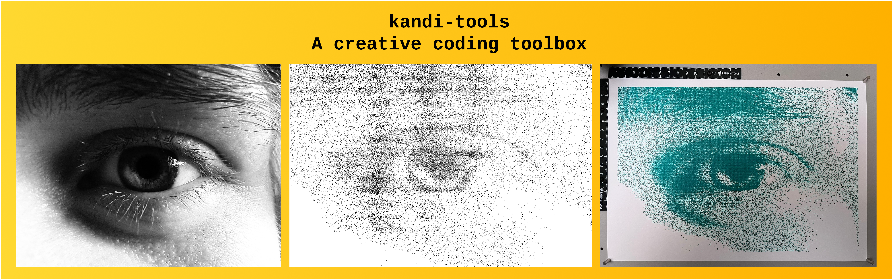

# kandi-tools



**kandi-tools** is a small creative coding toolbox for JavaScript, aimed at generative art for pen plotters and print: sampling, hatching, curves, noise, colour unmixing and layered SVG export in real-world units.

It has zero dependencies, and every algorithm is written from scratch in plain, readable code. It grew out of wanting to build my own tools in a modular way, **and to actually understand them**. It is in many ways inspired by the [canvas-sketch](https://github.com/mattdesl/canvas-sketch/) ecosystem by Matt DesLauriers. Definitely check it out!

It's a work in progress, and best used in through [kandi](https://github.com/wassilyevich/kandi); suggestions and issues are welcome. Happy coding!

## Install

```bash
npm install kandi-tools
```

## Quick start in kandi

```js
import { createSVG, addLayer, addPolyline } from "kandi-tools/svg";

// kandi stuff vvvvvvvvvvvv
// Standard sketch settings:
export const settings = {
    dimensions: "A4",
    dpi: 300,
    units: "mm",
    animate: false,
    clear: false,
};

export const exportSettings = {};

const sketch = ({ width, height, units, dpi }) => {
    const svgDoc = createSVG({ width, height, units });
    const layer = addLayer(svgDoc, "1-layer");
    const upperLeftCorner = {
        x: width / 2 - width / 10,
        y: height / 2 - height / 10,
    };
    const rectWidth = width / 5;
    const rectHeight = height / 5;
    return ({ context, width, height, time }) => {
        // Browser visualization - drawing a rectangle in the middle of the page
        // In kandi: CTRL + S to save a PNG
        context.strokStyle = "black";
        context.strokeRect(
            upperLeftCorner.x,
            upperLeftCorner.y,
            rectWidth,
            rectHeight,
        );
        // Doing the same for the actual SVG output
        // In kandi: CTRL + E to save a SVG
        addPolyline(layer, [
            { x: upperLeftCorner.x, y: upperLeftCorner.y },
            { x: upperLeftCorner.x + rectWidth, y: upperLeftCorner.y },
            {
                x: upperLeftCorner.x + rectWidth,
                y: upperLeftCorner.y + rectHeight,
            },
            {
                x: upperLeftCorner.x,
                y: upperLeftCorner.y + rectHeight,
            },
        ]);

        return { svgDocs: [{ svgDoc }] };
    };
};

export default sketch;
```

## Modules

| Module     | What it's for                                | Docs                                                                       |
| ---------- | -------------------------------------------- | -------------------------------------------------------------------------- |
| `geometry` | Generating and manipulation geometric stuff  | [geometry](https://github.com/wassilyevich/kandi-tools/tree/main/geometry) |
| `math`     | General purpose math stuff                   | [math](https://github.com/wassilyevich/kandi-tools/tree/main/math)         |
| `random`   | Seedable Pseudo-Random stuff                 | [random](https://github.com/wassilyevich/kandi-tools/tree/main/random)     |
| `color`    | Analyzing and converting color               | [color](https://github.com/wassilyevich/kandi-tools/tree/main/color)       |
| `svg`      | Creating plottable SVG files                 | [svg](https://github.com/wassilyevich/kandi-tools/tree/main/svg)           |
| `analysis` | Data/point analysis algorithms               | [analysis](https://github.com/wassilyevich/kandi-tools/tree/main/analysis) |
| `images`   | Image import and analysis (**browser only**) | [images](https://github.com/wassilyevich/kandi-tools/tree/main/images)     |

## Conventions

- Points are { x, y } objects - **tip**: use destructuring when possible
- Angles in radians
- Anything random takes an optional `random` function: pass createPRNG(seed).random for reproducible output
- Units: whatever you put in; svg maps them to the provided `units` string during export

## Known limitations

0.x: API may change. images is browser-only. noise3d not implemented yet.

## Related

kandi-tools is created as a toolbox specifically for [kandi](https://github.com/wassilyevich/kandi): the CLI tool to scaffold sketches and have a dev-server for live tweaking.
[My website](www.wassi.art)
[My Instagram](https://www.instagram.com/wassi.lyevich/)
[My Substack](https://wassilyevich.substack.com/)

## License

ISC © Daan Van Cauteren
