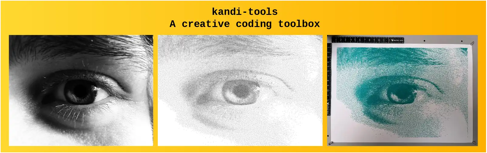

# kandi-tools



**kandi-tools** is a small creative coding toolbox for JavaScript, aimed at generative art for pen plotters and print: sampling, hatching, curves, noise, colour unmixing and layered SVG export in real-world units.

It has zero dependencies, and every algorithm is written from scratch in plain, readable code. It grew out of wanting to build my own tools in a modular way, **and to actually understand them**. It is in many ways inspired by the [canvas-sketch](https://github.com/mattdesl/canvas-sketch/) ecosystem by Matt DesLauriers. Definitely check it out!

It's a work in progress, and best used through [kandi](https://github.com/wassilyevich/kandi); suggestions and issues are welcome. Happy coding!

## Install

```bash
npm install kandi-tools
```

## Quick start

```js
import { writeFileSync } from "node:fs";
import { poissonDisk } from "kandi-tools/geometry";
import { createPRNG } from "kandi-tools/random";
import { createSVG, addLayer, addCircle, svgToString } from "kandi-tools/svg";

const { random } = createPRNG(42);
const svg = createSVG({ width: 210, height: 297, units: "mm" });
const layer = addLayer(svg, "dots");

for (const p of poissonDisk(210, 297, 8, 30, random))
    addCircle(layer, p.x, p.y, 1.5);

writeFileSync("dots.svg", svgToString(svg));
```

## Modules

| Module     | What it's for                                                         | Docs                                                                       |
| ---------- | --------------------------------------------------------------------- | -------------------------------------------------------------------------- |
| `geometry` | Generating and manipulating points, curves, and polygons              | [geometry](https://github.com/wassilyevich/kandi-tools/tree/main/geometry) |
| `math`     | Often used mathematical formulations/functions not included in `Math` | [math](https://github.com/wassilyevich/kandi-tools/tree/main/math)         |
| `random`   | Seedable random functions inclusing noise and pick                    | [random](https://github.com/wassilyevich/kandi-tools/tree/main/random)     |
| `color`    | Analyzing and converting color                                        | [color](https://github.com/wassilyevich/kandi-tools/tree/main/color)       |
| `svg`      | Creating plottable SVG files                                          | [svg](https://github.com/wassilyevich/kandi-tools/tree/main/svg)           |
| `analysis` | Analyzing data/points - _more complex_ algorithms                     | [analysis](https://github.com/wassilyevich/kandi-tools/tree/main/analysis) |
| `images`   | Image import and analysis (**browser only**)                          | [images](https://github.com/wassilyevich/kandi-tools/tree/main/images)     |

## Conventions

- Points are `{ x , y }` objects, and are referred to as `Point2` - **tip**: use destructuring when possible
- Angles in radians
- Anything random takes an optional `random` function: pass `createPRNG(seed).random` for reproducible output
- Units: whatever you put in; svg maps them to the provided `units` string during export

## Known limitations

0.x: API may change. images is browser-only. noise3d not implemented yet.

## Related

- kandi-tools is created as a toolbox specifically for [kandi](https://github.com/wassilyevich/kandi): the CLI tool to scaffold sketches and have a dev-server for live tweaking.
- [My website](https://wassi.art)
- [My Instagram](https://www.instagram.com/wassi.lyevich/)
- [My Substack](https://wassilyevich.substack.com/)

## License

ISC © Daan Van Cauteren
