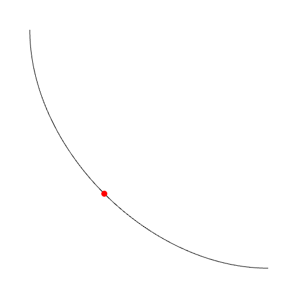
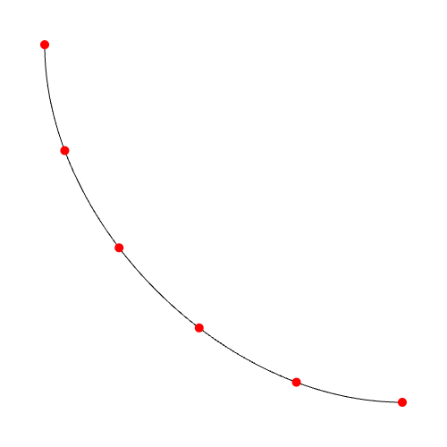
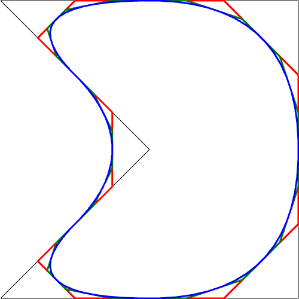
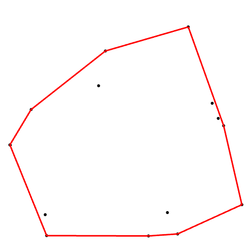
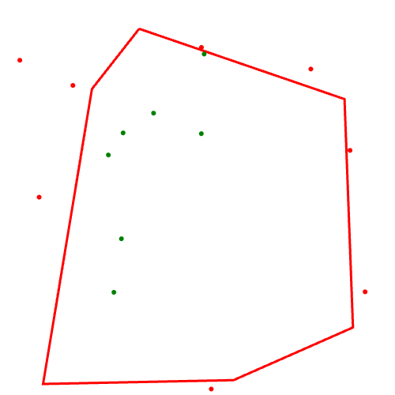
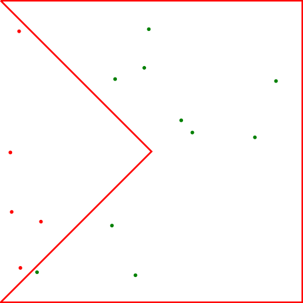
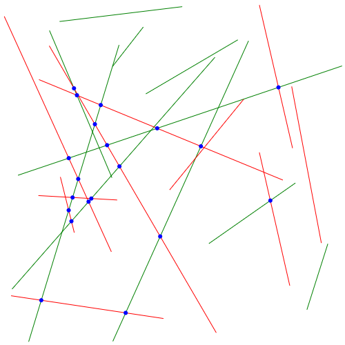

# geometry

This module contains useful functions to generate, analyze, and modify geometric content such as points, lines, curves, and polygons.

Example import:

```js
import { poissonDisk, hatchFill } from "kandi-tools/geometry";
```

## Contents

- [poissonDisk](#poissondisk)
- [poissonDiskPolygon](#poissondiskpolygon)
- [poissonDiskVariable](#poissondiskvariable)
- [hatchFill](#hatchfill)
- [bezierPoint](#bezierpoint)
- [sampleBezier](#samplebezier)
- [chaikin](#chaikin)
- [convexHull](#convexhull)
- [grahamScan](#grahamscan)
- [isInsideHull](#isinsidehull)
- [isInsidePolygon](#isinsidepolygon)
- [distance2d](#distance2d)

## Functions

### poissonDisk

```js
poissonDisk(width, height, minDist, maxAttempts?, random?, origin?)
```

> Randomly distribute 2D points in a rectangular area with quasi-even spacing using Poisson Disk sampling.

| Parameter     | Type     | Default       | Description                                                                                     |
| ------------- | -------- | ------------- | ----------------------------------------------------------------------------------------------- |
| `width`       | number   |               | width of the sampling area                                                                      |
| `height`      | number   |               | height of the sampling area                                                                     |
| `minDist`     | number   |               | desired minimum distance between points (controls the density of points)                        |
| `maxAttempts` | number   | 30            | maximum number of attempts to try and generate a new point                                      |
| `random`      | function | `Math.random` | callback function that generates random values between [0-1] (use a seedable PRNG if necessary) |
| `origin`      | point    | `{x:0, y:0}`  | origin parameter for correct offsetting                                                         |

**Returns** an array of points: `Array<Point2>`

Minimal example (pseudo-code):

```js
// Spawn points in a 500 x 500 square with minimum distance of 5
const points = poissonDisk(500, 500, 5);
points.forEach((p) => {
    context.beginPath();
    context.arc(p.x, p.y, 1, 0, 2 * Math.PI);
    context.fill();
});
```


---

### poissonDiskPolygon

```js
posissonDiskPolygon(polygon, minDist, maxAttempts?, random?)
```

> Randomly distribute 2D points in a polygonal area with quasi-even spacing using Poisson Disk sampling.

| Parameter     | Type            | Default       | Description                                                                                     |
| ------------- | --------------- | ------------- | ----------------------------------------------------------------------------------------------- |
| `polygon`     | `Array<Point2>` |               | polygon to fill with evenly spaced points                                                       |
| `minDist`     | number          |               | desired minimum distance between points (controls the density of points)                        |
| `maxAttempts` | number          | 30            | maximum number of attempts to try and generate a new point                                      |
| `random`      | function        | `Math.random` | callback function that generates random values between [0-1] (use a seedable PRNG if necessary) |

**Returns** an array of points: `Array<Point2>`

Minimal example (pseudo-code):

```js
// Spawn points in a 500 x 500 square, with a dent, with minimum distance of 5
const polygon = [
    { x: 0, y: 0 },
    { x: 500, y: 0 },
    { x: 500, y: 500 },
    { x: 0, y: 500 },
    { x: 500 / 2, y: 500 / 2 },
];
const points = poissonDiskPolygon(polygon, 5);
points.forEach((p) => {
    context.beginPath();
    context.arc(p.x, p.y, 1, 0, 2 * Math.PI);
    context.fill();
});
```


---

### poissonDiskVariable

```js
poissonDiskVariable(width, height, radiusAt, rMin, {maxAttempts?, random?, origin?, seedSpacing?})
```

> Poisson disk sampling with a spatially varying minimum distance

| Parameter     | Type          | Default       | Description                                                                                     |
| ------------- | ------------- | ------------- | ----------------------------------------------------------------------------------------------- |
| `width`       | number        |               | width of the sampling area                                                                      |
| `height`      | number        |               | height of the sampling area                                                                     |
| `radiusAt`    | function(x,y) |               | callback function that returns the sampling distance at a position `(x,y)`                      |
| `rMin`        | number        |               | global minimum distance (clamping minimum)                                                      |
| `maxAttempts` | number        | 30            | maximum number of attempts to try and generate a new point                                      |
| `random`      | function      | `Math.random` | callback function that generates random values between [0-1] (use a seedable PRNG if necessary) |
| `origin`      | point         | `{x:0, y:0}`  | origin parameter for correct offsetting                                                         |
| `seedSpacing` | point         | `4 * rMin`    | seed for shuffled seed grid (Fisher-Yates approach)                                             |

**Returns** an array of points: `Array<Point2>`

Minimal example (pseudo-code):

```js
// Spawn points in a 500 x 500 square, with variable spacing depending on a given function
const fun = (x, y) => {
    return (x + y) / 20;
};
const points = poissonDiskVariable(500, 500, fun, 5);
points.forEach((p) => {
    context.beginPath();
    context.arc(p.x, p.y, 1, 0, 2 * Math.PI);
    context.fill();
});
```


---

### hatchFill

```js
hatchFill(polygon, angle, spacing);
```

> Hatch a polygon using straight lines, with a chosen spacing between them

| Parameter | Type            | Default | Description                                                                                               |
| --------- | --------------- | ------- | --------------------------------------------------------------------------------------------------------- |
| `polygon` | `Array<Point2>` |         | polygon to hatch                                                                                          |
| `angle`   | number          |         | angle at which the lines are drawn (0 = horizontal)                                                       |
| `spacing` | number          |         | spacing between the hatch lines (if the stroke width is equal to the spacing, the polygon will be filled) |

**Returns** line segments: `Array<[Point2, Point2]>`

Minimal example (pseudo-code):

```js
// Hatch a 500 x 500 square, with a dent, using vertical lines with a spacing of 5
const polygon = [
    { x: 0, y: 0 },
    { x: 500, y: 0 },
    { x: 500, y: 500 },
    { x: 0, y: 500 },
    { x: 500 / 2, y: 500 / 2 },
];
const segments = hatchFill(polygon, Math.PI / 2, 5);

context.beginPath();
for (const [start, end] of segments) {
    context.moveTo(start.x, start.y);
    context.lineTo(end.x, end.y);
}
context.stroke();
```


---

### bezierPoint

```js
bezierPoint(p1, cp1, cp2, p2, t);
```

> Sample a point along a cubic Bézier curve at position `t`

| Parameter | Type     | Default | Description                                            |
| --------- | -------- | ------- | ------------------------------------------------------ |
| `p1`      | `Point2` |         | starting point of the curve                            |
| `cp1`     | `Point2` |         | first control point                                    |
| `cp2`     | `Point2` |         | second control point                                   |
| `p2`      | `Point2` |         | ending point of the curve                              |
| `t`       | number   |         | parametric position at which to sample the curve [0-1] |

**Returns** a point: `Point2`

Minimal example (pseudo-code):

```js
// Draw a cubic Bézier curve and highlight the halfway point in red
const p1 = { x: 50, y: 50 };
const cp1 = { x: 500 / 10, y: 500 / 2 };
const cp2 = { x: 500 / 2, y: 500 - 500 / 10 };
const p2 = { x: 450, y: 450 };
const points = [];
for (let i = 0; i <= 100; i++) {
    points.push(bezierPoint(p1, cp1, cp2, p2, i / 100));
}
for (let i = 0; i < points.length - 1; i++) {
    context.moveTo(points[i].x, points[i].y);
    context.lineTo(points[i + 1].x, points[i + 1].y);
}
context.stroke();
context.fillStyle = "red";
context.beginPath();
const redPoint = bezierPoint(p1, cp1, cp2, p2, 0.5);
context.arc(redPoint.x, redPoint.y, 5, 0, 2 * Math.PI);
context.fill();
```



---

### sampleBezier

```js
sampleBezier(p1, cp1, cp2, p2, n);
```

> Sample equally divided points along a cubic Bézier curve

| Parameter | Type     | Default | Description                               |
| --------- | -------- | ------- | ----------------------------------------- |
| `p1`      | `Point2` |         | starting point of the curve               |
| `cp1`     | `Point2` |         | first control point                       |
| `cp2`     | `Point2` |         | second control point                      |
| `p2`      | `Point2` |         | ending point of the curve                 |
| `n`       | number   |         | number of equal divisions along the curve |

**Returns** an array of points: `Array<Point2>`

Minimal example (pseudo-code):

```js
// Draw a cubic Bézier curve and highlight the 5 equidistant points along the curve in red
const p1 = { x: 50, y: 50 };
const cp1 = { x: 500 / 10, y: 500 / 2 };
const cp2 = { x: 500 / 2, y: 500 - 500 / 10 };
const p2 = { x: 450, y: 450 };
const points = [];
for (let i = 0; i <= 100; i++) {
    points.push(bezierPoint(p1, cp1, cp2, p2, i / 100));
}
const redPoints = sampleBezier(p1, cp1, cp2, p2, 5);
for (let i = 0; i < points.length - 1; i++) {
    context.moveTo(points[i].x, points[i].y);
    context.lineTo(points[i + 1].x, points[i + 1].y);
}
context.stroke();
context.fillStyle = "red";
for (let i = 0; i < redPoints.length; i++) {
    context.beginPath();
    context.arc(redPoints[i].x, redPoints[i].y, 5, 0, 2 * Math.PI);
    context.fill();
}
```



---

### chaikin

```js
chaikin(points, iterations, ratio?, closed?)
```

> Smooth a polyline using the Chaikin smoothing (corner cutting)

| Parameter    | Type            | Default | Description                                                             |
| ------------ | --------------- | ------- | ----------------------------------------------------------------------- |
| `points`     | `Array<Point2>` |         | non-smooth polyline that is smoothed                                    |
| `iterations` | number          |         | number of recursive iterations (higher means smoother, and more points) |
| `ratio`      | number          | 0.25    | relative positioning of the lower cut (0 - 0.5) (both exclusive)        |
| `closed`     | boolean         | `false` | boolean to tell the algorithm whether the polyline is closed or not     |

**Returns** a smoothed polyline: `Array<Point2>`

Minimal example (pseudo-code):

```js
// Draw a polygon and draw the 3 chaikin smoothed version in red, green, and blue, with increased iterations
context.fillStyle = "black";
const polyline = [
    { x: 1, y: 1 },
    { x: 500 - 1, y: 1 },
    { x: 500 - 1, y: 500 - 1 },
    { x: 1, y: 500 - 1 },
    { x: 500 / 2, y: 500 / 2 },
];
context.beginPath();
context.strokeStyle = "black";
for (let i = 0; i < polyline.length - 1; i++) {
    context.moveTo(polyline[i].x, polyline[i].y);
    context.lineTo(polyline[i + 1].x, polyline[i + 1].y);
}
context.lineTo(polyline[0].x, polyline[0].y);
context.stroke();
context.lineWidth = 3;

const redPoints = chaikin(polyline, 1, 0.25, true);
const greenPoints = chaikin(polyline, 2, 0.25, true);
const bluePoints = chaikin(polyline, 4, 0.25, true);
context.strokeStyle = "red";
context.beginPath();
for (let i = 0; i < redPoints.length - 1; i++) {
    context.moveTo(redPoints[i].x, redPoints[i].y);
    context.lineTo(redPoints[i + 1].x, redPoints[i + 1].y);
}
context.lineTo(redPoints[0].x, redPoints[0].y);
context.stroke();
context.strokeStyle = "green";
context.beginPath();
for (let i = 0; i < greenPoints.length - 1; i++) {
    context.moveTo(greenPoints[i].x, greenPoints[i].y);
    context.lineTo(greenPoints[i + 1].x, greenPoints[i + 1].y);
}
context.lineTo(greenPoints[0].x, greenPoints[0].y);
context.stroke();
context.strokeStyle = "blue";
context.beginPath();
for (let i = 0; i < bluePoints.length - 1; i++) {
    context.moveTo(bluePoints[i].x, bluePoints[i].y);
    context.lineTo(bluePoints[i + 1].x, bluePoints[i + 1].y);
}
context.lineTo(bluePoints[0].x, bluePoints[0].y);
context.stroke();
```

_Algorithm: George Chaikin, 1974_



---

### convexHull

```js
convexHull(points, algorithm?);
```

> Finds the convex hull of a set of 2D points

| Parameter   | Type            | Default  | Description                                         |
| ----------- | --------------- | -------- | --------------------------------------------------- |
| `points`    | `Array<Point2>` |          | points to fin the convex hull for                   |
| `algorithm` | `string`        | `graham` | used algorithm - currently only support Graham Scan |

**Returns** a result object:

```js
{
    hull: Array<Point2>,
    algorithm: string,
    inputCount: number,
    hullCount: number
}
```

Minimal example (pseudo-code):

```js
// Draw the convex hull around 15 randomly spawned points
const nPoints = 15;
const points = [];
for (let i = 0; i < nPoints; i++) {
    points.push({
        x: Math.random() * 500,
        y: Math.random() * 500,
    });
}
const hull = convexHull(points, "graham").hull;
context.fillStyle = "black";
context.strokeStyle = "red";
context.lineWidth = 3;
for (let i = 0; i < nPoints; i++) {
    context.beginPath();
    context.arc(points[i].x, points[i].y, 3, 0, 2 * Math.PI);
    context.fill();
}
context.beginPath();
context.moveTo(hull[0].x, hull[0].y);
for (let i = 0; i < hull.length; i++) {
    context.lineTo(hull[i].x, hull[i].y);
}
context.lineTo(hull[0].x, hull[0].y);
context.stroke();
```

_Graham scan algorithm: Ronald Graham, 1972_



---

### grahamScan

```js
grahamScan(points);
```

> Finds the convex hull of a set of 2D points using Graham Scan (convexHull uses this function)

| Parameter | Type            | Default | Description                       |
| --------- | --------------- | ------- | --------------------------------- |
| `points`  | `Array<Point2>` |         | points to fin the convex hull for |

**Returns** a result object:

```js
{
    hull: Array<Point2>,
    hullCount: number
}
```

The same example as in [convexHull](#convexhull) can be used, since it uses the exact same algorithm.

---

### isInsideHull

```js
isInsideHull(point, hull);
```

> Finds whether a point lies insde a convex hull or not. _Note: when not sure if the provided points are a convex hull, use [isInsidePolygon](#isinsidepolygon)_

| Parameter | Type            | Default | Description                            |
| --------- | --------------- | ------- | -------------------------------------- |
| `point`   | `Point2`        |         | point to check against the convex hull |
| `hull`    | `Array<Point2>` |         | convex hull to check point against     |

**Returns** a `boolean`

Minimal example (pseudo-code):

```js
// Draw a convex hull and draw points inside it as green, points outside it as red
const nPoints = 15;
const nCheckPoints = 15;
const points = [];
for (let i = 0; i < nPoints; i++) {
    points.push({
        x: Math.random() * 500,
        y: Math.random() * 500,
    });
}
const hull = convexHull(points, "graham").hull;
const checkPoints = [];
for (let i = 0; i < nCheckPoints; i++) {
    checkPoints.push({
        x: Math.random() * 500,
        y: Math.random() * 500,
    });
    if (isInsideHull(checkPoints[i], hull)) {
        checkPoints[i].color = "green";
    } else {
        checkPoints[i].color = "red";
    }
}
context.strokeStyle = "red";
context.beginPath();
context.moveTo(hull[0].x, hull[0].y);
for (let i = 0; i < hull.length; i++) {
    context.lineTo(hull[i].x, hull[i].y);
}
context.lineTo(hull[0].x, hull[0].y);
context.stroke();
for (let i = 0; i < nCheckPoints; i++) {
    context.beginPath();
    context.fillStyle = checkPoints[i].color;
    context.arc(checkPoints[i].x, checkPoints[i].y, 3, 0, 2 * Math.PI);
    context.fill();
}
```



---

### isInsidePolygon

```js
isInsidePolygon(point, polygon);
```

> Finds whether a point lies insde a polygon or not.

| Parameter | Type            | Default | Description                            |
| --------- | --------------- | ------- | -------------------------------------- |
| `point`   | `Point2`        |         | point to check against the convex hull |
| `polygon` | `Array<Point2>` |         | polygon to check point against         |

**Returns** a `boolean`

Minimal example (pseudo-code):

```js
// Draw a polygon and draw points inside it as green, points outside it as red
const polygon = [
    { x: 1, y: 1 },
    { x: 500 - 1, y: 1 },
    { x: 500 - 1, y: 500 - 1 },
    { x: 1, y: 500 - 1 },
    { x: 500 / 2, y: 500 / 2 },
];
const nCheckPoints = 15;
const checkPoints = [];
for (let i = 0; i < nCheckPoints; i++) {
    checkPoints.push({
        x: Math.random() * 500,
        y: Math.random() * 500,
    });
    if (isInsidePolygon(checkPoints[i], polygon)) {
        checkPoints[i].color = "green";
    } else {
        checkPoints[i].color = "red";
    }
}
context.fillStyle = "black";
context.strokeStyle = "red";
context.lineWidth = 3;
context.beginPath();
context.moveTo(polygon[0].x, polygon[0].y);
for (let i = 0; i < polygon.length; i++) {
    context.lineTo(polygon[i].x, polygon[i].y);
}
context.lineTo(polygon[0].x, polygon[0].y);
context.stroke();
for (let i = 0; i < nCheckPoints; i++) {
    context.beginPath();
    context.fillStyle = checkPoints[i].color;
    context.arc(checkPoints[i].x, checkPoints[i].y, 3, 0, 2 * Math.PI);
    context.fill();
}
```



---

### distance2d

```js
distance2d(p1, p2);
```

> Calculate the Euclidean distance between 2 2D points

| Parameter | Type     | Default | Description  |
| --------- | -------- | ------- | ------------ |
| `p1`      | `Point2` |         | first point  |
| `p2`      | `Point2` |         | second point |

**Returns** a number

Minimal example (pseudo-code):

```js
// Spawn a number points and connect them via lines, only draw lines that are within cutoff distance
const cutoff = width / 10;
const nPoints = 100;
const points = [];
for (let i = 0; i < nPoints; i++) {
    points.push({
        x: Math.random() * 500,
        y: Math.random() * 500,
    });
}
const lines = [];
for (let i = 0; i < nPoints; i++) {
    for (let j = 0; j < nPoints; j++) {
        if (i === j) continue;
        lines.push({
            points: [
                { x: points[i].x, y: points[i].y },
                { x: points[j].x, y: points[j].y },
            ],
            draw: distance2d(points[i], points[j]) <= cutoff ? true : false,
        });
    }
}
context.fillStyle = "black";
for (let i = 0; i < nPoints; i++) {
    context.beginPath();
    context.arc(points[i].x, points[i].y, 3, 0, 2 * Math.PI);
    context.fill();
}
for (let i = 0; i < lines.length; i++) {
    if (lines[i].draw) {
        context.beginPath();
        context.moveTo(lines[i].points[0].x, lines[i].points[0].y);
        context.lineTo(lines[i].points[1].x, lines[i].points[1].y);
        context.stroke();
    }
}
```


---

### lineIntersection2D

```js
lineIntersection2d(p1, p2, p3, p4, segment?)
```

> Finds the intersection point of 2 lines defined by 4 points

| Parameter | Type      | Default | Description                                                            |
| --------- | --------- | ------- | ---------------------------------------------------------------------- |
| `p1`      | `Point2`  |         | first point (line 1)                                                   |
| `p2`      | `Point2`  |         | second point (line 1)                                                  |
| `p3`      | `Point2`  |         | third point (line 2)                                                   |
| `p4`      | `Point2`  |         | fourth point (line 2)                                                  |
| `segment` | `boolean` | false   | the point is only returned if it lies between the bounds of both lines |

| **Returns** a point: `Point2`

Minimal example (pseudo-code):

```js
// Draw lines connecting random points and visualize their intersections in blue
const p1 = [];
const p2 = [];
const p3 = [];
const p4 = [];
const nLines = 10;
const intersections = [];
for (let i = 0; i < nLines; i++) {
    p1.push({
        x: Math.random() * 500,
        y: Math.random() * 500,
    });
    p2.push({
        x: Math.random() * 500,
        y: Math.random() * 500,
    });
    p3.push({
        x: Math.random() * 500,
        y: Math.random() * 500,
    });
    p4.push({
        x: Math.random() * 500,
        y: Math.random() * 500,
    });
}
for (let i = 0; i < nLines; i++) {
    for (let j = 0; j < nLines; j++) {
        if (i === j) continue;
        if (lineIntersection2d(p1[i], p2[i], p3[j], p4[j], true)) {
            intersections.push(
                lineIntersection2d(p1[i], p2[i], p3[j], p4[j], true),
            );
        }
    }
}
for (let i = 0; i < nLines; i++) {
    context.strokeStyle = "green";
    context.beginPath();
    context.moveTo(p1[i].x, p1[i].y);
    context.lineTo(p2[i].x, p2[i].y);
    context.stroke();
    context.strokeStyle = "red";
    context.beginPath();
    context.moveTo(p3[i].x, p3[i].y);
    context.lineTo(p4[i].x, p4[i].y);
    context.stroke();
}
context.fillStyle = "blue";
for (let i = 0; i < intersections.length; i++) {
    context.beginPath();
    context.arc(intersections[i].x, intersections[i].y, 3, 0, 2 * Math.PI);
    context.fill();
}
```


